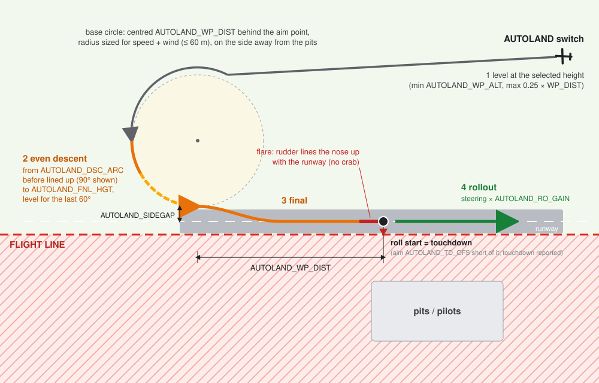
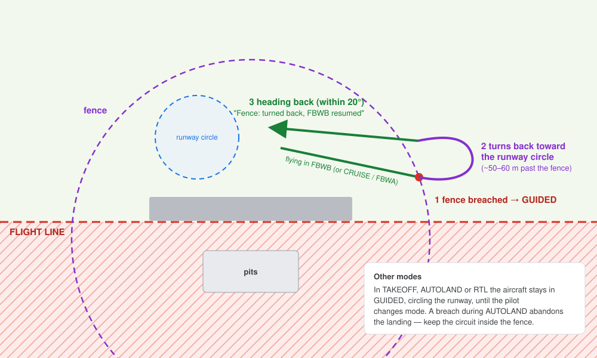

# ArduPlane AMA Field Mode

**Auto takeoff, fly in FBWB, one switch to land – without ever crossing the flight
line.**

A set of extensions added to, and re-compiled as, **ArduPlane 4.7.2** for flying as a new pilot in training at a typical club (AMA) field:
The 
one runway, with the pits and pilots' line along one side of it. The usual rule at
such a field is that nothing flies on the pilot side of the runway. Stock ArduPlane
modes don't know where the pits are. They will loiter, turn onto final or come home
right over the pilot line. This firmware learns the field layout at power-up and
takeoff, then keeps every automatic part of the flight on the far side of the runway.

The goal is a setup that a new pilot can fly safely:

- **AUTO TAKEOFF** from where you lined up (pointed the aircraft straight down the runway - on one switch.
  by hand). It holds the runway line in a crosswind and
  climbs to a holding circle beside the runway, away from the pits.
- **FBWB** Once ready, the pilot flips into FBWB as the everyday flying mode. It holds altitude and won't go below a floor
  height. If it hits the fence it turns back toward the field and hands control
  back to the pilot.
- **AUTOLAND** on one switch. It flies a level circuit on the far side, comes down
  the base circle at one even sink rate, levels off before the final, glides gently
  down the final and kicks out the crab in the flare. It touches down near where the
  takeoff roll started, then holds the runway heading until it stops.

The inherent behaviour is built into ArduPlane, this custom version essentially controls where the plane is allowed to fly, so it works on **any board and any airframe
that takes off from a runway**. That means a conventional plane with a rudder, GPS
and compass; a rangefinder is optional and will increase landing accuracy. Development and flight testing used one
aircraft, a Freewing Pandora. Its settings are included only as a
[worked example](#example-aircraft).

> **Experimental firmware.** Everything here was tested in ArduPilot SITL and on one
> airframe over about 20 flights. Experienced pilots should set up and test the aircraft before handing to a new pilot. Initial setup should test every change with a thumb on the mode switch
> and a MANUAL fallback, and follow your club's and the AMA's safety code.

**Minimum hardware**

- **An ArduPilot flight controller that runs ArduPlane 4.7**, with its barometer. See list of boards and compiled builds on the Releases tab.
  Every ArduPilot board has one.
- **A fuselage vent** if the flight controller is inside the fuselage: any
  fuselage that air can get into needs an exit opening of at least 1 square inch,
  ideally more, behind the flight controller, wherever the motor is (see
  [Fuselage vent](#fuselage-vent-required)).
- **GPS**: for the pits reference, the roll start (landing point) and the runway
  direction.
- **Compass**: required. ArduPlane can fly without one, but the field mode can't.
  The heading the aircraft is lined up on at idle is the takeoff heading and the
  check on the runway direction, so TAKEOFF is refused without a healthy compass.
- **A wheeled aircraft with a rudder** that takes off from a runway or grass strip.
  A steerable tail or nose wheel is best.
- Optional: a downward rangefinder for a more precise flare and touchdown. An airspeed
  sensor isn't needed.

Details are in [What your aircraft needs](#6-what-your-aircraft-needs).

The original ArduPilot README is in [README-ArduPilot.md](README-ArduPilot.md).

---

## Download firmware

Ready-to-flash firmware for about 30 fixed-wing flight controllers is on the
**[latest release](https://github.com/ramiss/ardupilot_ama_field/releases/latest)**.

1. **Find your board.** The release notes have a table of every board. File names
   end in ArduPilot's name for the board, such as `MatekF405-Wing` or `CubeOrange`.
   It must match your flight controller exactly. If you're not sure of the name,
   look up your board on ArduPilot's
   [autopilot hardware list](https://ardupilot.org/plane/docs/common-autopilots.html).
2. **Pick the file:**
   - `.apj` if the board already runs ArduPilot. Flash it with Mission Planner:
     *Install Firmware → Load custom firmware*.
   - `_with_bl.hex` if it runs INAV or Betaflight. Flash it once over DFU; the
     release notes explain how.
3. Your board isn't listed, or is marked "not available"? Build it yourself; see
   [DEVELOPMENT.md](ama-field/docs/DEVELOPMENT.md#building).

Only the FlyingRC F4Wing Mini has been flight-tested. The other boards compile but
haven't flown this firmware. Ground-test first, and fly with a MANUAL/FBWA override
switch.

Some 1 MB boards don't fit the full firmware, so they ship a **trimmed** build with
less-used features removed, such as QuadPlane, soaring and camera/gimbal support.
The release notes list exactly what each trimmed board is missing.

---

## Contents

1. [The field it is designed for](#1-the-field-it-is-designed-for)
2. [A flight, step by step](#2-a-flight-step-by-step)
3. [Takeoff and the runway circle](#3-takeoff-and-the-runway-circle)
4. [The AUTOLAND circuit](#4-the-autoland-circuit)
5. [Fence bounce-back](#5-fence-bounce-back)
6. [What your aircraft needs](#6-what-your-aircraft-needs)
7. [Getting started](#7-getting-started)
8. [Parameter reference](#8-parameter-reference)
9. [Messages you will hear and see](#9-messages-you-will-hear-and-see)
10. [Limitations and safety notes](#10-limitations-and-safety-notes)
11. [Example aircraft](#example-aircraft)
12. [More documentation](#more-documentation)

---

## 1. The field it is designed for

The design assumes:

- **One runway** used in one direction per flight. The direction is whichever way
  you line up for takeoff: the aircraft must point straight down the runway, because
  the landing comes in along that same line.
- **Pits and pilots on one side of the runway**, behind a flight line. The firmware
  learns which side from where the aircraft is powered up.
- **A circular fence** around HOME (`FENCE_RADIUS`) that the whole circuit fits
  inside.
- Optional **obstacles** (trees, buildings) on the far side or at the ends. A
  minimum circuit height clears them.

Nothing about the field has to be entered as coordinates. The firmware learns the
field in two moments:

| When | What it learns | How |
|---|---|---|
| Power-up in the pits | **Which side the pits are on** | The first good GPS fix is saved as the pits reference. Arming waits for it. |
| Takeoff roll | **Runway position and direction**, and the **touchdown point** | It saves the spot where the aircraft last stood still and the compass heading lined up there. It also uses the GPS track of the roll. |

So the same firmware and parameters work at any field. Power up in the pits, then
take off with TAKEOFF.

---

## 2. A flight, step by step

1. **Power up in the pits**, behind the flight line. Wait for *"Autoland: GPS fix
   point saved"*.
2. **Arm**, taxi or carry the aircraft to the runway, **line it up**, pointing it
   straight down the centreline by hand, and **stop**. Any angle to the runway
   becomes the landing direction too (see [Lining up](#3-takeoff-and-the-runway-circle)).
3. **Select TAKEOFF.** It rolls, lifts off and climbs out along the runway line,
   then circles on the **runway circle** beside the runway, away from the pits.
4. **Fly in FBWB.** The stick sets climb/descent and speed; altitude is held when
   you let go. The fence turns it back automatically.
5. **Flip AUTOLAND** at about the circuit height you want. It flies the circuit,
   lands near where the takeoff roll began, and disarms after `LAND_DISARMDELAY`.
6. To fly again, **disarm and re-arm**. A second auto takeoff on the same arming is
   refused.

---

## 3. Takeoff and the runway circle

> **Lining up.** Before selecting TAKEOFF, point the aircraft by hand (or by taxiing)
> exactly straight down the runway centreline, then stop. The firmware takes the
> direction the aircraft points at idle as the takeoff heading. The roll follows
> it, and the landing direction comes from the roll and that heading. Nothing
> corrects it to the runway: an aircraft lined up 10° off rolls 10° off, and
> AUTOLAND then lands 10° across the runway. The final still ends at the roll
> start, but 100 m out it is about 17 m to the side of the centreline, and the
> rollout carries on across the runway at the same angle.

**Before the roll**
- TAKEOFF is refused on the ground if there is no compass heading or the pits side
  is unknown. It is also refused if this arming has already flown.
- When TAKEOFF is accepted, the steering and attitude integrators are reset. Taxiing
  can't leave the rudder wound up at the start of the roll.

**The roll and climb-out**
- The roll steers the heading you lined up on, so line up straight (see *Lining
  up* above).
- The **roll start** is the last point where the armed aircraft stood still. It is
  saved as the touchdown reference.
- The **runway direction** is the GPS track of the roll. If the roll veered more
  than 8° off the lined-up heading, the compass heading measured at idle is used
  instead, so a swerve can't misalign the landing. A crooked line-up still does:
  both directions come from it.
- Climb-out **tracks the runway line** itself, not just a point ahead. A crosswind
  can't drift the climb over the pits.
- **Tail hold and rotation release once airborne.** Stock ArduPlane holds the tail
  down (`TKOFF_TDRAG_ELEV`), keeps the ground pitch and limits the bank until the
  airspeed reaches `TKOFF_TDRAG_SPD1` / `TKOFF_ROTATE_SPD`. Without an airspeed
  sensor that is an estimate, which can read far too low on the climb-out (on the
  test aircraft into a strong headwind, 4.5–7 m/s up to 39 m, with the tail hold
  cycling on and off against the pitch). Here, 1.5 m above the start of the takeoff
  at 5 m/s or more over the ground, those speeds count as reached: *"Takeoff:
  airborne, tail hold released"*.

**The runway circle**
- At `TKOFF_ALT` the aircraft loiters on a circle **abeam the roll start, on the
  side away from the pits**.
- The near edge is `AUTOLAND_SIDEGAP` + 10 m from the centreline.
- The radius is sized from cruise speed, the wind estimate and the bank limit, so
  the circle it actually flies stays on its side of the runway. The centre is
  recalculated every few seconds as the wind estimate settles.
- The same circle is the **RTL** destination and the **fence-return** target.

---

## 4. The AUTOLAND circuit

1. **Level at the selected height.** The circuit height is the height when AUTOLAND
   is selected. It is limited to between `AUTOLAND_WP_ALT` (the minimum, for
   obstacles) and 0.25 × `AUTOLAND_WP_DIST` (the maximum, so the final isn't too
   steep). Selected higher than that, it holds altitude to the circle and comes down
   on it. Selected lower than `AUTOLAND_WP_ALT`, it climbs.
2. **Base circle on the far side.** It is centred `AUTOLAND_WP_DIST` behind the
   touchdown aim, `AUTOLAND_SIDEGAP` from the extended centreline. The radius is
   sized for speed and wind, up to 60 m, so the turn onto final ends lined up rather
   than overshooting across the centreline toward the pits.
3. **Even descent on the base circle.** The aircraft starts descending
   `AUTOLAND_DSC_ARC` degrees before it is lined up and comes down at one even sink
   rate to `AUTOLAND_FNL_HGT`, reached 60° before lined up. The last 60° of the turn
   are flown level, so the aircraft is settled before the final starts.
   - Arriving from downwind, the turn onto final is about 180°, so 180 starts the
     descent as that turn begins (about 1.8 m/s from 21 m to 8 m on the example
     aircraft).
   - The descent only starts once the aircraft is established on the circle. If that
     is past the start point (a value bigger than the arrival turn, such as 240), it
     starts there, as long as at least 60% of the descent is still ahead.
   - Too small a value leaves too little turn for the height to lose: below about
     150 on a 20 m circuit you see *"Autoland: descent N m/s, raise AUTOLAND_DSC_ARC"*.
   - If it reaches the end of the turn more than 2.5 m high it flies one more lap,
     coming down to `AUTOLAND_FNL_HGT` on it, rather than dive.
   - Set `AUTOLAND_DSC_ARC` to 0 to stay level until lined up.
4. **Gentle final.** A straight glide from `AUTOLAND_FNL_HGT` at the circle exit to
   the touchdown aim (8 m over 85 m is about 5.4°, 1.5 m/s at 16 m/s). At that sink
   rate the flare has little to do. The base circle ends `AUTOLAND_SIDEGAP` to the
   far side of the runway line, so the turn can't overshoot toward the pits; on the
   final the line is tracked with 0.6 × `NAVL1_PERIOD`, so the aircraft is on the
   centreline early in the final instead of converging over most of it. This
   replaces the stock behaviour of diving at `TECS_SINK_MAX` straight after the
   turn.
5. **Flare.** The rudder points the nose down the runway, removing the crosswind
   crab, instead of steering the ground track. The touchdown aim is
   `AUTOLAND_TD_OFS` short of the roll start; the float after the flare carries the
   aircraft on toward it. Every landing reports where it touched down
   (*"Autoland: touchdown +4m from roll start"*), so you can adjust
   `AUTOLAND_TD_OFS` by hand.
6. **Rollout.** Steering is multiplied by `AUTOLAND_RO_GAIN` from touchdown until the
   aircraft stops, so it holds the runway heading as the rudder loses authority.

The height profile is the key safety behaviour. Stock AUTOLAND starts descending as
soon as it is selected, so it can arrive low over trees on the downwind leg. Here
the circuit stays at or above `AUTOLAND_WP_ALT` until the descent start on the base
circle. From there the aircraft comes down over the base circle, behind the
touchdown aim on the far side, to `AUTOLAND_FNL_HGT`: that area and the approach
must be clear of obstacles down to that height. A smaller `AUTOLAND_DSC_ARC` keeps
it higher for longer over the circle, at the cost of a faster sink.

---

## 5. Fence bounce-back

With `FENCE_ACTION` 6 (Guided) and `FENCE_RET_RALLY` 0:

- **In FBWB, FBWA or CRUISE**, a breach switches to GUIDED and turns toward the
  runway circle. Once back inside the fence and heading home (within 20°), it returns
  to the mode the pilot was flying: *"Fence: turned back, FBWB resumed"*. A novice
  who flies too far gets turned around and keeps flying.
- **In TAKEOFF, AUTOLAND or RTL**, a breach stays in GUIDED, circling the runway
  circle, until the pilot changes mode. A breach during AUTOLAND abandons the
  landing, so size the circuit to fit inside the fence.

Expect the aircraft to go 50–60 m past the fence before it has turned (small foam
aircraft at ~14 m/s; more for faster aircraft).

---

## 6. What your aircraft needs

| Need | Why |
|---|---|
| **Takeoff from a runway or grass strip** (wheels) | The touchdown point and runway direction are captured from the takeoff roll, which must be 15–250 m long. Hand or bungee launches capture nothing, and AUTOLAND then refuses with *"no takeoff point captured"*. |
| **GPS** | Pits reference, roll start, runway direction. |
| **Compass** (healthy, calibrated) | Lined-up heading. TAKEOFF is refused without it. |
| **Rudder**, ideally with a **steerable nose or tail wheel** | Ground steering on the roll, flare de-crab and rollout steering. A flying wing without a rudder gets the circuit, but none of the steering behaviour. |
| **Any ArduPilot board that runs ArduPlane 4.7** | The features are in ArduPlane itself, not in a board definition, and add only a little flash. |
| Downward **rangefinder** (optional) | Refines touchdown detection and the flare. Any ArduPilot rangefinder works: the field mode uses only its `RNGFND1_MIN`, `RNGFND1_MAX` and `RNGFND1_GNDCLR`, its status and, if it reports one, its signal quality. **Range matters:** a sensor that really reaches 4 m or more outdoors (a Benewake TF-Luna, or a longer-range lidar or radar) lets the rangefinder decide the flare on any final; a small ToF sensor like the MicoAir MT-06 only engages at about 2.5–3 m. A **minimum range** above the sensor's height on the wheels (the TF-Luna's 0.2 m) is handled by blind-zone touchdown detection. See [TUNING.md 2.4](ama-field/docs/TUNING.md#24-rangefinder-or-not) and [section 10](#10-limitations-and-safety-notes). |
| **Fuselage vent** (board inside the fuselage) | Any fuselage that air can get into needs an exit of at least 1 square inch, ideally more, behind the flight controller, wherever the motor is. Without it the baro reads metres wrong. See [Fuselage vent](#fuselage-vent-required). |
| Airspeed sensor (optional) | Not needed; the test aircraft had none. |

### Fuselage vent (required)

**Any fuselage that air can get into must also let it out.** If the flight
controller sits inside the fuselage, give it an exit opening of **at least 1 square
inch (6.5 cm²), ideally more, behind (aft of) the flight controller**. This applies
wherever the motor and prop are: tractor, pusher or twin.

- **Why:** air comes in through every opening that faces the airflow: the cowling
  and motor mount, cooling inlets, hatch and canopy gaps, servo and wheel cutouts.
  At flying speed that ram air pressurises the cabin on its own, and a prop in front
  of an opening adds its wash. The barometer reads the cabin pressure as a lower
  altitude, and every height in the circuit, the final and the flare comes from the
  barometer.
- **On the example aircraft** (Freewing Pandora) the closed fuselage made the baro
  read about 4 m low at full throttle standing still. With one opening cut behind
  the flight controller, a run-up to 61% throttle moved it by 0.07 m, and it stayed
  within about 0.5 m for the whole flight.
- **Size and place:**
  - make the exit at least as large as the openings letting air in, and never less
    than 1 square inch; several smaller openings add up;
  - put it behind the flight controller, so air flows in, past the board and out;
  - face it aft or to the side, out of the prop wash, never forward into the
    airflow.
- **Not a fix:** foam over the baro chip, because the pressure is the same
  throughout the fuselage. Leave `BARO1_THST_SCALE` and `BARO1_WCF_ENABLE` at 0:
  the field mode relies on a vented fuselage, not on software compensation.
- **Check it before the first AUTOLAND:**
  - **Run-up:** restrain the aircraft, keep clear of the prop, and with the hatches
    and cowl as flown, hold 0, 50 and 100% throttle for a few seconds each while
    watching the altitude in Mission Planner. It should stay within about ±0.5 m.
  - **In flight:** the run-up only shows the prop wash, not the ram air at flying
    speed (on a pusher it shows almost nothing). With a rangefinder, the log's
    `ALRF.Corr` on each AUTOLAND final is the baro error and should stay within
    about ±1 m. Without one, compare the altitude on a fast low pass with your eye
    or a known height.
  - If the altitude drops with throttle or speed, open the vent further.

Flying wings and open-frame aircraft with the board in free air don't need a vent,
but the same checks apply.

**Airframe types**

| Type | Notes |
|---|---|
| Taildragger | Tested. Hold the tail down with `TKOFF_TDRAG_ELEV` (positive) and release it just below rotate speed with `TKOFF_TDRAG_SPD1`. A tail that lifts early loses tailwheel steering. |
| Tricycle | Use `TKOFF_TDRAG_ELEV` 0, or negative to hold the nosewheel down, and a lower `LAND_PITCH_DEG` (about 3–5°) so it lands on the mains. Expect less rollout steering trouble. |
| Belly lander / skids | Not supported: the roll capture needs a wheeled takeoff roll. |
| Hand launch, bungee, VTOL | Not supported: no takeoff roll to capture. |

**Included extras from the test aircraft.** These are not needed for the field mode:

- A board definition for the **FlyingRC F4Wing Mini**, which is not in upstream
  ArduPilot. It has MAVLink logging to an external logger enabled.
- Signal quality reporting and a raw-sample log (`RFSS`) for **TOFSense-F / MicoAir
  MT-06** and **Benewake I2C (`RNGFND1_TYPE` 25, TFmini Plus; TF-Luna, if it is
  detected)** rangefinders. The TOFSense-F is polled at 50 Hz.
- A **rangefinder plausibility gate** in ArduPlane. It rejects readings that disagree
  with baro height, unless the sensor reports a strong signal. This applies to any
  rangefinder and protects against bad readings at approach height.
- **Rangefinder handling on the AUTOLAND final, for any sensor:**
  - it is taken into use once its readings have followed the aircraft's own descent
    for 0.2 s (6 samples if the signal is weak or unreported: 0.5 s at 10 Hz);
  - the rangefinder correction is held as the aircraft goes below the sensor's
    minimum range;
  - touchdown is detected from the ground clearance, or from the blind zone below
    the minimum range.

---

## 7. Getting started

1. **Flash the firmware** for your board from the
   [latest release](#download-firmware), or build it yourself (see
   [DEVELOPMENT.md](ama-field/docs/DEVELOPMENT.md#building)).
2. **Set up the aircraft as normal**:
   - calibrations, radio and servo directions;
   - `AIRSPEED_CRUISE`, `AIRSPEED_MIN`, `TRIM_THROTTLE`;
   - **autotune** in FBWA;
   - fly it in FBWA and FBWB until it is well trimmed.
3. **Load [`ama-field/params/ama_field_core.param`](ama-field/params/ama_field_core.param)**.
   It switches the mode on (`AUTOLAND_OPTIONS` 6) with conservative starting values.
   Then work through every line marked FIELD or AIRFRAME.
4. **Put TAKEOFF, FBWB and AUTOLAND within reach.** For example:
   - TAKEOFF and FBWB on the mode switch;
   - AUTOLAND on its own switch (`RCx_OPTION` 183);
   - MANUAL or FBWA on another switch as the pilot's way out.
5. **Tune in order**: takeoff, circuit, descent and final, flare and touchdown point,
   then rollout. Follow the [quick start](#quick-start) below,
   with [TUNING.md](ama-field/docs/TUNING.md) for how to choose starting values for
   your airframe and what to change for each symptom.

### Quick start

For an aircraft that is already set up and flying well in FBWA/FBWB. Only the AMA
field settings are listed; everything else is stock ArduPlane.

**1. Turn it on**

- Load [`ama_field_core.param`](ama-field/params/ama_field_core.param). It sets
  `AUTOLAND_OPTIONS` 6 (land at the roll start, circuit away from the pits), the
  fence bounce-back (`FENCE_ACTION` 6, `FENCE_RET_RALLY` 0), RTL to the runway circle
  (`RTL_AUTOLAND` 0, no rally points) and the circle descent and gentle final.
- Put AUTOLAND on a switch (`RCx_OPTION` 183) and TAKEOFF and FBWB on the mode
  switch.

**2. Fit the circuit to the field**

| Parameter | Set to | Typical |
|---|---|---|
| `AUTOLAND_WP_ALT` | Tallest obstacle near the circuit + 5 m. The circuit never goes lower before the final. | 20 m |
| `AUTOLAND_WP_DIST` | Final length, about 6–8 s at landing speed. | 80–120 m |
| `AUTOLAND_SIDEGAP` | Gap between the centreline and the base circle. | 5–15 m |
| `AUTOLAND_DSC_ARC` | Degrees before lined up where the descent starts. 180 = as the turn from downwind begins. Smaller = later and steeper; the base circle must be clear down to `AUTOLAND_FNL_HGT`. | 150–180 |
| `AUTOLAND_FNL_HGT` | Height at the start of the final. Lower = a gentler final but lower over the ground before the aim point. | 8 m |
| `CRUISE_ALT_FLOOR` | FBWB/CRUISE floor, usually = `AUTOLAND_WP_ALT`. | 20 m |
| `FENCE_RADIUS`, `FENCE_ALT_MAX` | Big enough for `AUTOLAND_WP_DIST` + `AUTOLAND_TD_OFS` + base circle radius behind the roll start, and `AUTOLAND_SIDEGAP` + 2 × radius to the side, plus the fence overshoot. | 240–300 m |

The base circle radius is sized automatically from speed, wind and `ROLL_LIMIT_DEG`
([TUNING.md 2.3](ama-field/docs/TUNING.md#23-checking-the-circuit-fits-the-fence)).

**3. The touchdown point**

`AUTOLAND_TD_OFS` (default 25 m) aims the landing that far short of the roll start
to allow for the float after the flare. Each landing reports where it touched down
and suggests a value; set it by hand from those reports (step 6). Nothing changes it
automatically.

**4. Airframe settings the field mode relies on**

| Parameter | Set to | Why |
|---|---|---|
| `TECS_PITCH_MIN` | -12 | Limits the nose-down pitch in the automatic modes, so no part of the approach can turn into a dive (about 3.3 m/s at 16 m/s). |
| `STEER2SRV_I` | 0 | Stops the integrator winding up while taxiing. |
| `TKOFF_TDRAG_ELEV` / `_SPD1` | Taildragger: 30–60 / just below `TKOFF_ROTATE_SPD`. Tricycle: 0 or negative. | Holds the steering wheel on the ground for the roll. |
| `AUTOLAND_RO_GAIN` | 1, raised 0.5–1 at a time | Rollout steering as the rudder loses authority. |
| `LAND_FLARE_SEC` / `_ALT`, `TECS_LAND_SINK`, `LAND_PITCH_DEG` | Core file values, then per airframe | The flare. Re-check `AUTOLAND_TD_OFS` after changing it. |
| `RNGFND_LANDING` | 1 with a downward rangefinder, else 0 | Optional, any sensor. Set `RNGFND1_MIN`, `_MAX` and `_GNDCLR` (measured on the wheels) correctly: the field mode uses them to decide engagement and touchdown. |

**5. Fly it**

- **Power up in the pits**, behind the flight line. The first GPS fix is the pits
  reference; arming waits for *"Autoland: GPS fix point saved"*.
- **Line up, stop at idle, select TAKEOFF.** Point the aircraft exactly straight
  down the runway by hand: the direction it points becomes the takeoff and landing
  direction, and any angle to the runway lands it across the runway by the same
  angle. The roll start becomes the landing point. One ground takeoff per arming.
- **Fly FBWB.** The fence turns the aircraft back and resumes the mode.
- **Flip AUTOLAND** at any height. It flies a level circuit on the far side, comes
  down the base circle, glides down the final and lands near the roll start
  (*"Autoland: touchdown +4m from roll start"*).
- **The throttle stick doesn't need centring.** In AUTOLAND it does nothing below
  half way (stock ArduPlane throttle nudge), so idle is the natural place for it.
  Above half it adds throttle and lengthens the landing.

**6. After the first landings**

- **Set the touchdown point.** After each landing you see *"Autoland: touchdown +4m
  from roll start"* and *"Autoland: suggest AUTOLAND_TD_OFS 29 (now 25)"*: the value that
  would have put that landing on the roll start (the current value plus the reported
  distance). Average the suggestions from a few landings and set that. Leave out
  landings with elevator or throttle input: those change where it touches down (the
  log's TDLN.PIn shows which landings had them).
- Symptom-by-symptom tuning of the circuit, flare and rollout is in
  [TUNING.md](ama-field/docs/TUNING.md); the
  [Pandora example](#example-aircraft) shows one finished setup.

---

## 8. Parameter reference

### New parameters

| Parameter | Default | Range | Typical | What it does |
|---|---|---|---|---|
| `AUTOLAND_SIDEGAP` | 0 | 0–100 m | 5–15 | Gap between the extended centreline and the near edge of the base circle. The runway circle uses this + 10 m. |
| `AUTOLAND_DSC_ARC` | 0 | 0–270° | 150–180 | Degrees before lined up at which the aircraft starts the circle descent (at least 90 with `AUTOLAND_FNL_HGT` set). 180 = as the turn from downwind begins. 0 = level until lined up. |
| `AUTOLAND_FNL_HGT` | 8 m | 0–50 m | 6–10 | Height at the start of the final, reached 60° before the end of the turn and held level to the final. 0 = one continuous glide from the descent start over the rest of the turn and the final. |
| `AUTOLAND_RO_GAIN` | 1.0 | 1–5 | 1–3 | Steering multiplier from touchdown until stopped. |
| `AUTOLAND_TD_OFS` | 25 | -50–100 m | 10–40 | Aims the landing this far short of the roll start to absorb the float after the flare. The default is a typical float. Set it by hand from the touchdown reports. |

### Existing parameters with a new meaning when `AUTOLAND_OPTIONS` = 6

| Parameter | Meaning |
|---|---|
| `AUTOLAND_OPTIONS` | Bit 1 (land at the roll start) + bit 2 (circuit away from the pits) = **6** enables everything here. With other values the firmware behaves like stock ArduPlane 4.7.2. |
| `AUTOLAND_WP_ALT` | **Minimum** circuit height (obstacle clearance). |
| `AUTOLAND_WP_DIST` | Final length: base circle distance behind the touchdown aim. It also sets the circuit height cap (0.25 ×). |

### Stock parameters the mode relies on

| Parameter | Setting | Why |
|---|---|---|
| `FENCE_ACTION` / `FENCE_RET_RALLY` | 6 / 0 | Guided return to the runway circle, and the bounce-back. |
| `FENCE_TYPE` / `FENCE_RADIUS` / `FENCE_ALT_MAX` | 3 / field | Circle plus ceiling. The circuit must fit inside. |
| `RTL_AUTOLAND` / `RALLY_TOTAL` | 0 / 0 | RTL goes to the runway circle. |
| `CRUISE_ALT_FLOOR` | field | FBWB and CRUISE won't descend below it. |
| `TKOFF_ALT` | field | Height of the runway circle after takeoff. |
| `TKOFF_TDRAG_ELEV` / `_SPD1`, `TKOFF_ROTATE_SPD`, `TKOFF_GND_PITCH` | airframe | Takeoff roll. |
| `TECS_PITCH_MIN` | -12 | Limits nose-down pitch in the automatic modes: a backstop against any dive on the approach. |
| `STEER2SRV_P` / `_I` / `_MINSPD` | airframe | Ground steering on roll, flare and rollout. `_I` 0 recommended. |
| `NAVL1_PERIOD` | airframe | Lower values track the circle and final more tightly. Too high and loiters fly wide. |
| `LAND_FLARE_SEC` / `_ALT`, `LAND_PITCH_DEG`, `TECS_LAND_SINK`, `TECS_LAND_ARSPD` | airframe | Flare and touchdown. |

Every parameter, with how to choose its value, is covered in
[TUNING.md](ama-field/docs/TUNING.md).

---

## 9. Messages you will hear and see

| Message | Meaning |
|---|---|
| Autoland: GPS fix point saved | Pits reference stored. Arming is now allowed. |
| PreArm: Autoland: no GPS fix point yet | Waiting for the first good GPS fix. |
| Takeoff blocked: no compass heading | TAKEOFF refused: the compass is not healthy. |
| Takeoff: pits Nm left, circle on right | TAKEOFF accepted on the ground: the pits reference is N m to that side of the lined-up runway line, and the runway circle and circuit will be on the other side. Check it matches the field before the roll. |
| Takeoff blocked: pits side unknown | TAKEOFF refused: it was powered up on the runway line, or the GPS fix is too close to it. Power cycle in the pits. |
| Takeoff blocked: disarm and re-arm first | TAKEOFF refused: this arming has already flown. |
| Autoland direction= N | Runway direction captured. Check it matches the runway. |
| Autoland: roll veered X, using line-up hdg N | The roll swerved more than 8°, so the lined-up compass heading is used. |
| Autoland: no target, roll Nm | Roll too short or long. AUTOLAND is unavailable this flight. |
| Autoland: target set Nm from home | Touchdown reference captured. |
| Takeoff: airborne, tail hold released | 1.5 m up before the airspeed estimate reached `TKOFF_TDRAG_SPD1` / `TKOFF_ROTATE_SPD`: the tail hold ends and the climb-out starts. |
| Takeoff: loiter abeam takeoff point | TAKEOFF moved to the runway circle. |
| Fence: turned back, MODE resumed | Fence bounce-back complete. |
| Autoland: circuit at Nm, descend on final | Circuit height chosen. |
| Autoland: circuit on left/right side | Circuit side (away from the pits). |
| Autoland: on circle, descending | It was selected above the height cap, and is now coming down on the base circle. |
| Autoland: no takeoff point captured | AUTOLAND refused. |
| Autoland: Nm high on the final turn, another lap | It reached the end of the base turn more than 2.5 m above `AUTOLAND_FNL_HGT` (it joined the circle too late to descend, or couldn't come down fast enough): one more lap instead of a dive. At most two extra laps. |
| Rangefinder engaged at Nm | The rangefinder is now used for the flare and touchdown. |
| Rangefinder can't see ground on wheels: blind-zone touchdown | At arming: `RNGFND1_GNDCLR` is below `RNGFND1_MIN`, so touchdown is detected from the range ending at the bottom (information only). |
| Rangefinder range below flare height: flare decided by baro | At arming: `RNGFND1_MAX` is less than `LAND_FLARE_ALT` + 1 m (information only). |
| Autoland: touchdown +Nm from roll start | Where this landing touched down, along the runway line: + past the roll start, − before it. |
| Autoland: suggest AUTOLAND_TD_OFS N (now M) | The `AUTOLAND_TD_OFS` that would have put this landing on the roll start (M + the distance above). Average a few and set it; nothing is changed automatically. |
| Autoland: descent N m/s, raise AUTOLAND_DSC_ARC | The descent arc is too short for the height to lose (more than 2.5 m/s planned). Usually followed by another lap. |
| Autoland: touchdown not seen | It disarmed before a touchdown was confirmed. |

---

## 10. Limitations and safety notes

- **It only knows the field from this power-up and this takeoff.** Always power up in
  the pits and take off with TAKEOFF. If you hand-launch, or take off manually, there
  is no touchdown reference.
- **The barometer must read true height on the approach.** Every height in the
  circuit, the final and the flare decision comes from it. A closed fuselage needs a
  vent: see [Fuselage vent](#fuselage-vent-required).
  - Air getting into the fuselage, through the cowling, gaps and cutouts, raises the
    pressure inside, so the baro reads low (about 4 m low at full throttle on the
    example aircraft before it was vented). Foam over the baro chip doesn't help:
    the pressure is the same throughout the fuselage.
  - **The fix is a vent** behind the flight controller. Leave `BARO1_THST_SCALE` and
    `BARO1_WCF_ENABLE` at 0.
- **Rangefinders: range matters.**
  - **Outdoor range is less than rated.** `RNGFND1_MAX` is only the configured
    limit; the *usable* range outdoors, in sun over grass, is often much shorter.
    The MT-06 gives strong returns only below about 2.5–3 m, so it engages at about
    2.5–3 m: enough to decide a flare at 2–3 m on the gentle final.
  - **A longer-range sensor decides the flare on any final.** A sensor that really
    reaches 4 m or more outdoors (a TF-Luna, rated 8 m at 90% reflectivity and
    2.5 m at 10%, or a lidar or radar) does. Measure your sensor's real range on
    the first flight (`RFSS` / `ALRF` in the log); don't assume it.
  - **Engagement is the same for every sensor:** readings that follow the
    aircraft's descent for 0.2 s, with or without a signal quality (a slow sensor
    without a strong signal needs 6 samples, 0.5 s at 10 Hz).
  - **Below the minimum range:** a sensor whose minimum range is above its height on
    the wheels (the TF-Luna's 0.2 m) is blind on the ground. Touchdown is then
    detected from the range ending at the bottom, with the baro height and the sink
    stopping.
  - **No rangefinder:** expect roughly the same landings; only the touchdown
    detection for `AUTOLAND_RO_GAIN` comes later.
- **The runway direction is only as good as your line-up.** Point the aircraft
  straight down the runway by hand before TAKEOFF; any angle carries into the
  landing, which then comes in across the runway (see
  [Lining up](#3-takeoff-and-the-runway-circle)).
- **Compass interference** from motor current shifts the heading. The lined-up
  heading is sampled with the motor below 20 % for this reason.
- **The fence overshoots** by roughly one turn diameter. Place the fence well inside
  the area you really need to protect.
- **A breach during AUTOLAND abandons the landing.** Keep the circuit inside the
  fence: roughly `AUTOLAND_WP_DIST` + `AUTOLAND_TD_OFS` + circle radius behind
  the roll start, and up to about 2 × radius + `AUTOLAND_SIDEGAP` to the side.
- **The base circle and the approach must be clear down to `AUTOLAND_FNL_HGT`.**
  The descent happens on the base circle, behind the touchdown aim on the far side.
  On a gentle final the aircraft is also under 2 m for the last 15–20 m before the
  aim point, which sits `AUTOLAND_TD_OFS` before the roll start: that ground must be
  clear too.
- **A gentler final floats less.** In SITL the gentle final touched down about 20 m
  shorter than a steep final with the same `AUTOLAND_TD_OFS`. Watch the
  touchdown reports on the first landings and lower `AUTOLAND_TD_OFS` if it lands
  short.
- **LOITER mode** circles wherever it is selected, including over the pits. Only the
  automatic modes described here know about the pits side.
- SITL can't model tailwheel steering. Ground handling was tuned from flight logs.

---

## Example aircraft

All flight testing was done on one aircraft:

| | |
|---|---|
| Airframe | Freewing Pandora, a 1.2 m foam high-wing taildragger, on 3S. Rudder and tailwheel share one output. |
| Flight controller | FlyingRC F4Wing Mini (STM32F405) |
| Sensors | u-blox GPS, external compass, no airspeed sensor, MicoAir MT-06 rangefinder (I2C) |
| Radio | ExpressLRS, EdgeTX with a spring-centred throttle |
| Field | Grass runway, pits along one side, trees beyond the far end |

Its settings are in
[`ama-field/params/examples/freewing_pandora_recommended.param`](ama-field/params/examples/freewing_pandora_recommended.param).
These values were right for that aircraft at that field, and they are there to show
what a finished setup looks like. They are **not defaults**: your aircraft's speed,
weight, drag and steering will need different values. Here is how its key values
compare with the core file:

| Parameter | Pandora (example) | Why on that aircraft |
|---|---|---|
| `AUTOLAND_WP_ALT` / `WP_DIST` | 20 / 85 | Trees beyond one end; a short final for a draggy foam aircraft. |
| Fuselage vent | an opening cut behind the flight controller | Closed, the fuselage pressurised with throttle (baro about 4 m low at full throttle). Vented, the baro stays within about 0.5 m. |
| `AUTOLAND_TD_OFS` | 25 | On a steeper final the wheels met the ground within about 5 m of the aim point (GPS). Re-check with the gentle final, which floats less. |
| `AUTOLAND_DSC_ARC` / `FNL_HGT` | 180 / 8 | An even ~1.8 m/s descent from the start of the half turn off downwind (trees under the downwind leg), level for the last 60°, then a 1.5 m/s final. |
| `TECS_PITCH_MIN` | -12 | Backstop: limits any dive on the approach to about 3.3 m/s. |
| `LAND_FLARE_SEC` | 2 | 1 s flared too late on a steep final. |
| `AUTOLAND_RO_GAIN` | 3 | The tailwheel lost authority as it slowed. |
| `TKOFF_TDRAG_ELEV` / `_SPD1` | 60 / 9 | Releasing the tail at 5 m/s lifted it early and lost steering. |
| `STEER2SRV_P` / `_I` | 6 / 0 | A light tailwheel needed about twice the nominal gain. I wound up while taxiing. |
| `TECS_LAND_SINK` / `LAND_PITCH_DEG` | 0.6 / 8 | 0.4 floated, 0.8 landed fast. Tail-low touchdown. |
| `NAVL1_PERIOD` | 13 | 17 flew circles about twice too wide in wind. |

A full parameter dump from one flight is also there
(`freewing_pandora_2026-11-15_full_dump.param`). It contains that aircraft's
calibration values. Use it for reference only, and never load it onto another
aircraft.

---

## More documentation

- **[TUNING.md](ama-field/docs/TUNING.md)**: choosing starting values for your
  airframe and field, the tuning order, and what to change for each symptom.
- **[DEVELOPMENT.md](ama-field/docs/DEVELOPMENT.md)**: building, SITL test scripts,
  log analysis scripts, the code changes, commits and version history.
